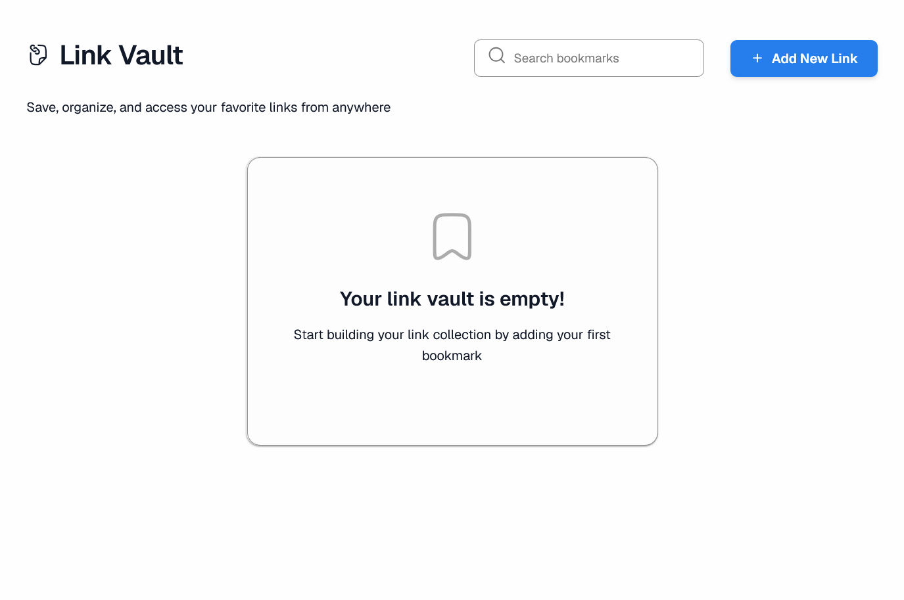

# Link Vault

A personal bookmark manager built with **React + TypeScript**. Save, organize, search, and filter your favorite links from a single, clean interface — no browser lock-in, no third-party CSS frameworks, just React state, hooks, and `localStorage`.

---

## App Preview



---

## Features

- **Full CRUD** — create, view, edit, and delete saved links.
- **Live search** — search across title, URL, description, and tags at once (debounced, so it stays smooth while typing).
- **Tag filtering** — segmented pill tabs above the search bar let you filter your links by tag, composable with the search box.
- **Toast notifications** — every add/edit/delete is confirmed with an auto-dismissing toast.
- **Fully responsive** — plain CSS with media queries at 480 / 768 / 1024 / 1200px, no Tailwind or Bootstrap.
- **Persistent** — all data is stored in the browser's `localStorage`, so your links survive a refresh.

---

## Tech Stack

| Layer | Choice |
|---|---|
| UI library | React 19 |
| Language | TypeScript |
| Build tool | Vite |
| Styling | Plain CSS (custom properties + media queries) |
| Persistence | Browser `localStorage` |
| Linting | oxlint |

---

## Project Structure

```text
vault-links-app/
├── index.html
├── package.json
├── src/
│   ├── main.tsx                 # App entry point
│   ├── App.tsx                  # Top-level layout
│   ├── LocalStorage/
│   │   └── localStorage.ts      # CRUD + persistence logic
│   └── components/
│       ├── LinkVault/           # Main container — owns state & handlers
│       ├── LinkForm/            # Add/edit modal
│       ├── LinkCard/            # Individual bookmark card
│       ├── TagTabs/             # Segmented tag-filter tabs
│       └── Notification/        # Toast notifications
```

---

## Getting Started

Follow these steps to set up and run the project locally.

### Prerequisites

Make sure you have the following installed:

- [Node.js](https://nodejs.org/) (LTS version recommended)
- npm (included with Node.js)
- [Git](https://git-scm.com/) for cloning the repository

### 1. Clone the Repository

Open your terminal (Command Prompt, PowerShell, or VS Code terminal) and run:

```bash
git clone https://github.com/Khaviso01/vault-links-app.git
```

Navigate into the project directory:

```bash
cd vault-links-app
```

> Replace the repository URL above if your GitHub repository uses a different URL.

### 2. Install Dependencies

Install all required project dependencies:

```bash
npm install
```

### 3. Start the Development Server

Run the following command:

```bash
npm run dev
```

The app will be available at:

```text
http://localhost:5173
```

Open the URL in your browser to view Link Vault.

---

## Available Scripts

```bash
npm run dev      # Start the development server
npm run build    # Type-check and produce a production build
npm run preview  # Preview the production build locally
npm run lint     # Run oxlint
```

---

## How It Works

Each saved link is stored as an object shaped like:

```ts
interface Link {
  id: string;
  title: string;
  url: string;
  description: string;
  tags: string[];
  createdAt: Date;
  updatedAt: Date;
}
```

All reads/writes go through a single `localStorageUtils` module, which keeps the entire link list under one storage key and handles the add/update/delete logic in one place.

`LinkVault` is the only "smart" component — it owns the state and passes data and callbacks down to presentational components like `LinkCard`, `LinkForm`, `SearchBar`, and `TagTabs`.

---

## Possible Improvements

- Expose the field-specific search filter (title/URL/description/tags) in the UI.
- Make tags on each `LinkCard` clickable to jump straight to that filter.
- Add automated tests (Vitest + React Testing Library).

---

## License

This project was built as part of a training task and is intended for educational/demo purposes.

## Author

**Khaviso Vukeya**
